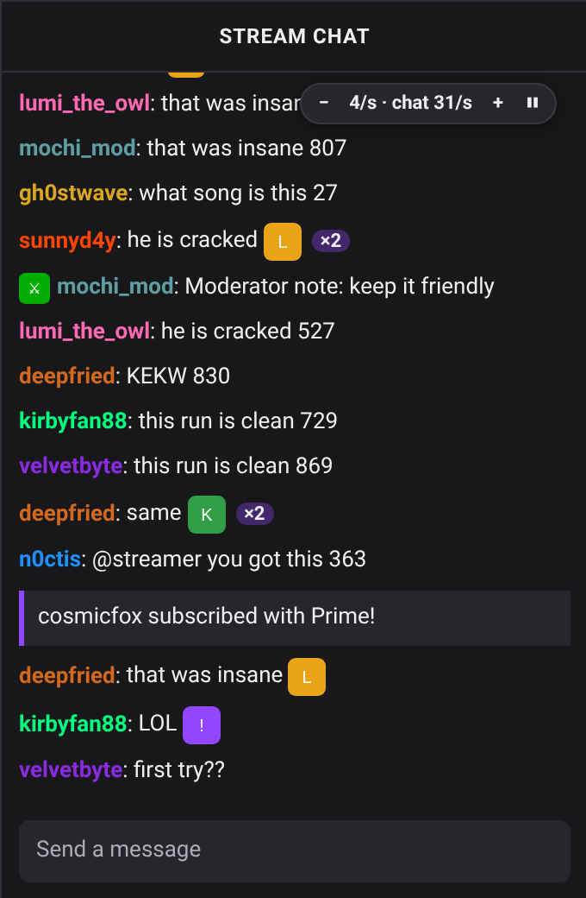
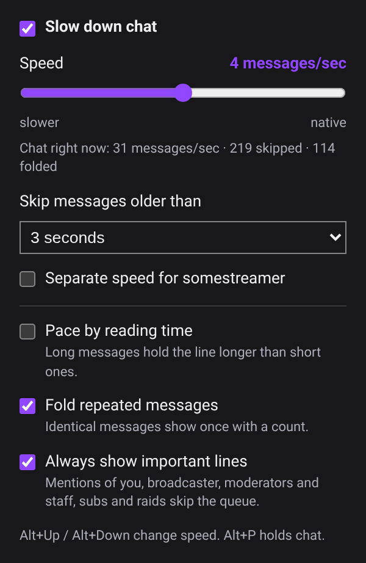

# Twitch Chat Speed

Chromium extension that releases Twitch chat messages at a rate you choose so busy chats stay readable. Works with the Twitch Anti-Ban proxy chat too.

  
  

Screenshots use a demo chat page, not live Twitch.

- **Speed:** 0.5 to 20 messages per second, or Native at the top of the slider. The popup shows the chat's live rate for reference.
- **Skip limit:** when chat outruns your speed, messages older than the limit are skipped so you stay near live.
- **Important lines skip the queue:** mentions of you, broadcaster, moderator and staff messages, subs and raids, and your own messages (capped at about 2 per second so bots cannot flood past it).
- **Folded repeats:** identical messages show once with a count, such as `Pog x120`.
- **Reading-time pacing:** optional; long messages hold the line longer than short ones.
- **Per channel:** give a channel its own speed from the popup.
- **On-page control:** slower, faster and hold buttons in the chat corner. Hotkeys: Alt+Up and Alt+Down change speed, Alt+P holds chat. Holding is limited to what Twitch keeps in the page (about 150 messages).

Install: open `chrome://extensions` (or `vivaldi://extensions`), enable Developer mode, Load unpacked, pick this folder.

GPL-3.0.
